<div align="center">

# Lune for Pi

### Light tools. Deeper work.

Eight cooperating extensions that turn the [Pi](https://pi.dev) coding agent into a calm, readable terminal workspace.<br>
See what the agent did, decide with context, keep long commands in reach, and pick up a session where you left it.

[Quick start](#quick-start) · [Tour](#a-short-tour) · [Packages](#the-family) · [Palettes](#palettes) · [Develop](#develop)

[](LICENSE)
[](package.json)
[](#the-family)

</div>

<br>

<picture>
  <source media="(prefers-color-scheme: light)" srcset="docs/previews/workspace-light.png">
  <source media="(prefers-color-scheme: dark)" srcset="docs/previews/workspace-dark.png">
  
</picture>

<p align="center"><sub>One Pi session with all seven extensions. Tool calls stay compact, the diff is in view, and the Dock keeps session state on one line.</sub></p>

<br>

## What Lune is

Pi is the coding agent. Lune is a set of extensions for it. You keep Pi's agent loop, models and commands; Lune changes how the session looks and adds the parts that a long day of agent work needs.

|                            |                                                                                                                   |
| -------------------------- | ----------------------------------------------------------------------------------------------------------------- |
| **Read the work**          | Each tool call is one compact line. Open it to see the arguments, output and a highlighted diff.                  |
| **Decide with context**    | The agent asks structured questions with options, previews and room for your own answer.                          |
| **Keep commands in reach** | Long shell jobs run in the background. Watch their live output, then let the result go back to the agent.         |
| **Return to the thread**   | Choose how the context is compacted, and get a short recap of the goal and progress when you come back.           |
| **Delegate side work**     | Hand a task to a subagent run. It works in its own session, optionally in its own Git worktree, and reports back. |

You can install all eight packages, or only the ones you want.

<br>

## A short tour

<p align="center">
  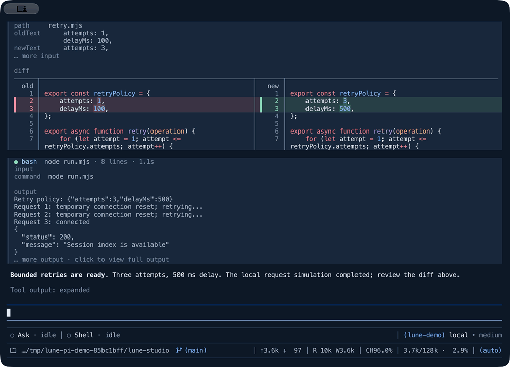
</p>

<p align="center"><sub>A question from the agent, answered in the panel. <a href="docs/previews/walkthrough.mp4"><b>Watch the full recording</b></a> for tool expansion, background jobs, the Dock, settings, Recap and compaction.</sub></p>

### Read the work at a glance

A busy transcript is easier to scan when each step is one line. Click a tool card, or press `ctrl+o`, to expand it. Edits show a split or unified diff with syntax highlighting, and long output stays folded until you ask for it.


### Decide with the full picture

When the agent needs a decision, it opens a panel instead of a wall of text. Move through the options and the preview on the right changes with them. Answer each tab, or type your own answer, then review and submit.

The question does not block the agent. It can continue with work that does not need your answer. Press `Esc` to close the panel and `/question` to open it again.

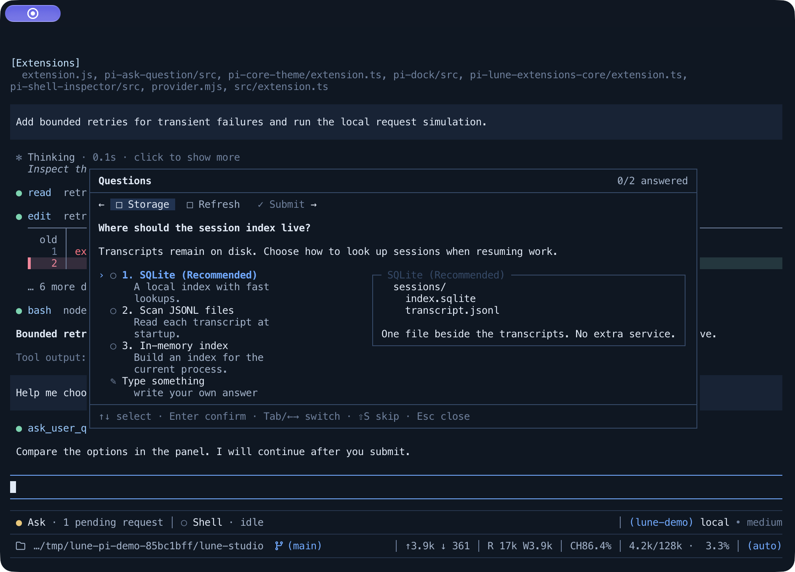

### Keep long commands in reach

Builds, indexes and test runs can go to the background. The Shell Inspector lists every job on the left and its live output on the right. When a job completes, fails or is cancelled, the agent receives the result. Running jobs stop when their Pi session ends.

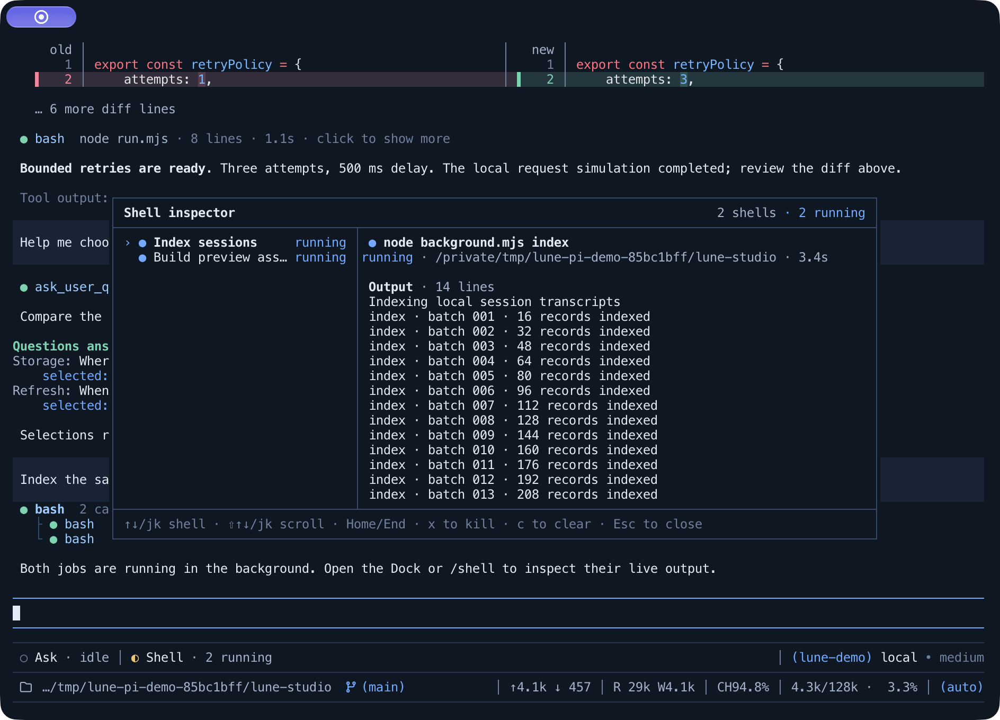

### Return to the thread

A short recap above the editor tells you the goal, the progress, and what to do next. Run `/recap` at any time, or turn on automatic recaps to have one ready when you return. Automatic mode needs a terminal that reports focus. For long sessions, Compaction lets you choose the summary model and thinking level, and optionally review tool history before it is summarized.

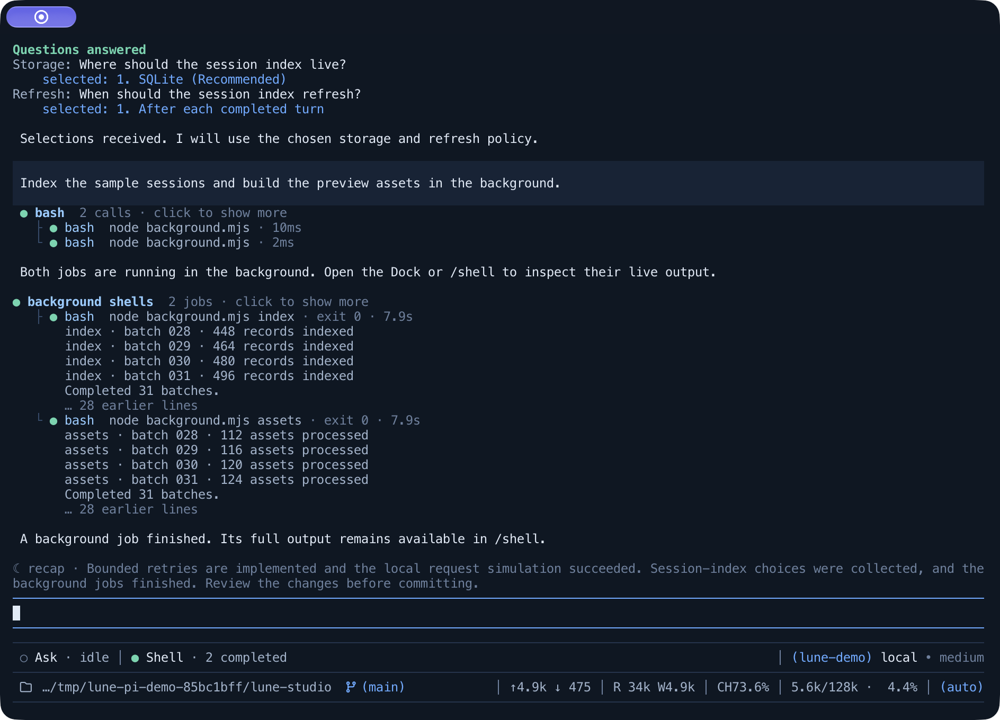

<details>
<summary><b>More screens</b>: Dock focus, compaction and settings</summary>
<br>

The Dock shows Ask and Shell status next to the model and session statistics. Press Down in an empty editor to focus it, Left and Right to select, and Enter to open.

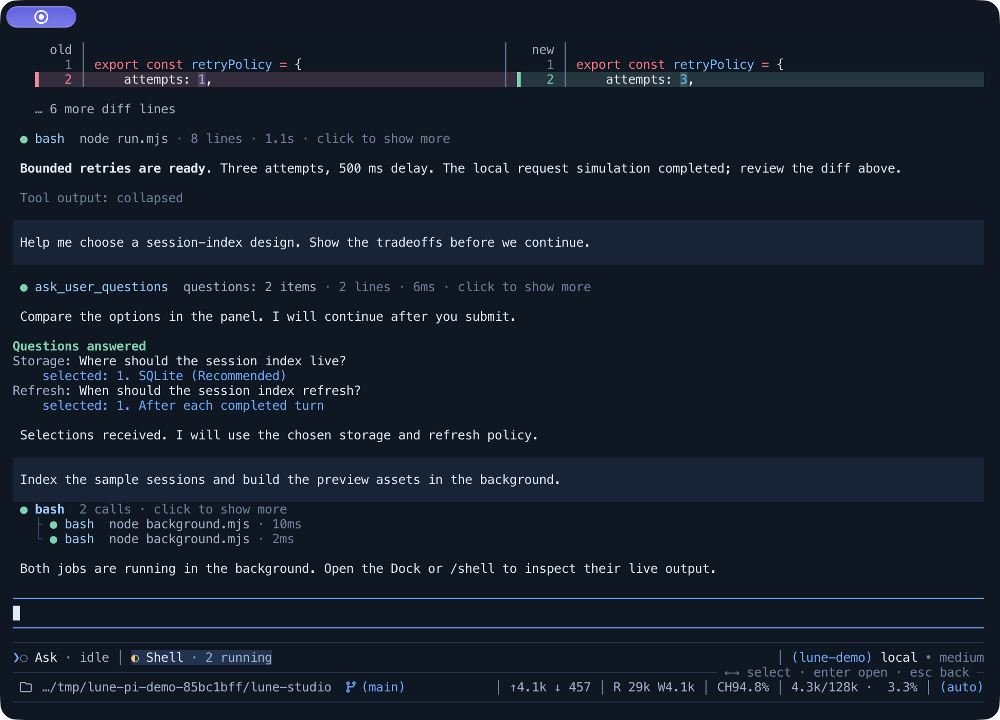

After `/compact`, the transcript shows the compaction result. Expand it to read the summary.

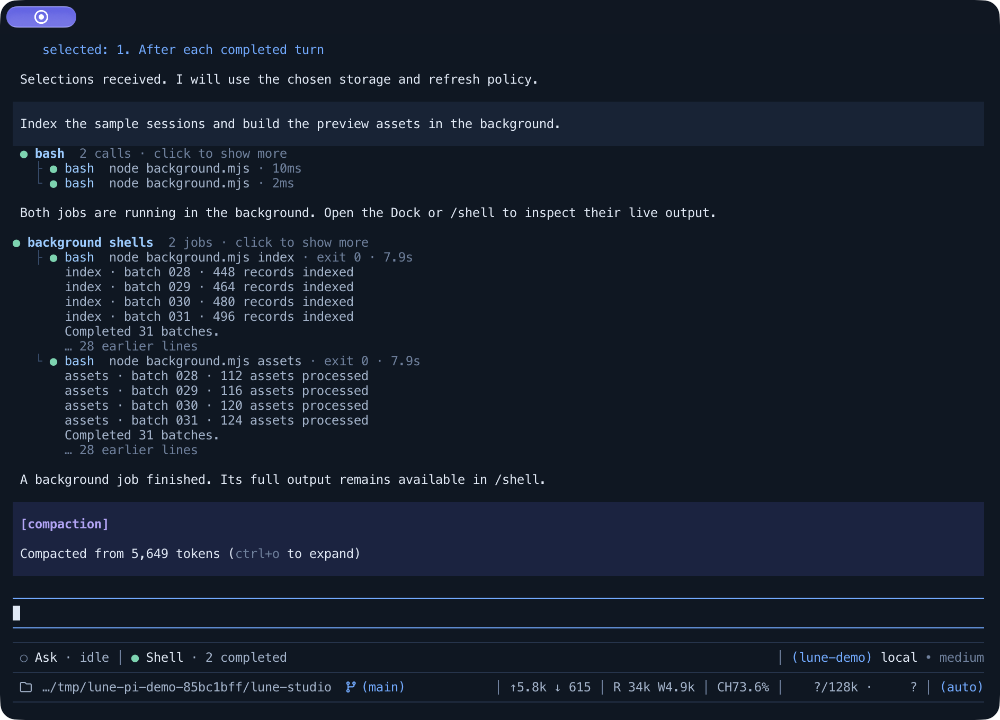

All Lune settings live in one panel. These are the Compaction and Theme tabs.

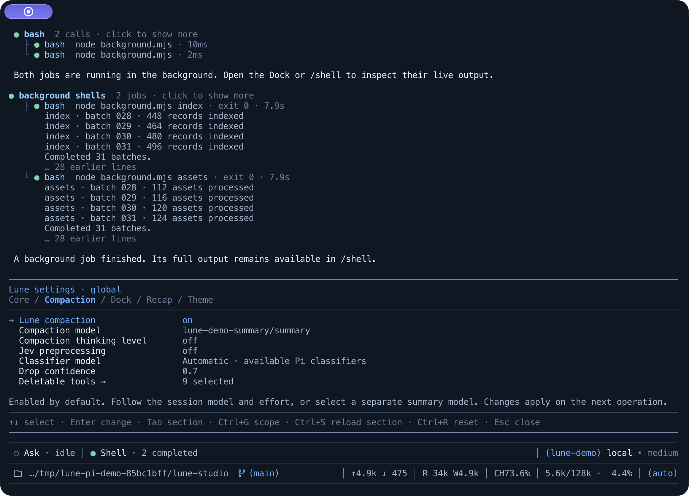

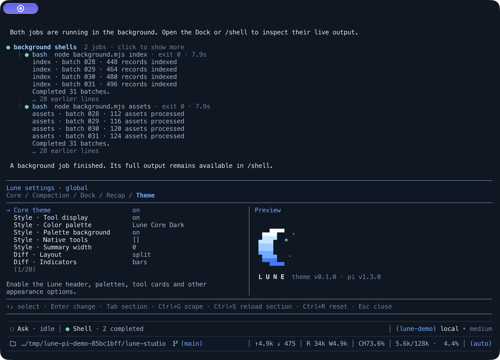

</details>

<sub>The screenshots and recording are native captures of Pi in Ghostty. A scripted offline provider gives repeatable model replies. Pi runs the agent loop, file edits, shell commands and all seven extensions normally. See [Preview assets](docs/previews/README.md).</sub>

<br>

## Quick start

You need [Pi](https://pi.dev), Node.js 22.19.0 or newer, and npm 11.

**1. Build the workspace.**

```bash
git clone https://github.com/Nouvelle-Lune/lune-pi.git
cd lune-pi
npm ci
npm run build
```

**2. Install the packages into Pi.** This installs the full family. Remove the lines for the packages you do not want. Keep Core, because it adds the `/lune-core-settings` panel.

```bash
pi install ./packages/pi-lune-extensions-core
pi install ./packages/pi-core-theme
pi install ./packages/pi-dock
pi install ./packages/pi-ask-question
pi install ./packages/pi-shell-inspector
pi install ./packages/pi-compaction
pi install ./packages/pi-recap
pi install ./packages/pi-subagent
```

Pi loads these packages from the checkout, so do not move or delete it.

**3. Start Pi and turn on the theme.**

```bash
pi
```

Core Theme is off by default. Run `/lune-core-settings core-theme`, enable **Core theme** in the **Theme** tab, and pick a palette in **Color palette**. Until you pick one, the palette follows your Pi theme.

### Everyday controls

| To do this                     | Use                                                |
| ------------------------------ | -------------------------------------------------- |
| Open all Lune settings         | `/lune-core-settings`                              |
| Expand or collapse tool output | `ctrl+o`                                           |
| Look at what is in the context | `/context`                                         |
| Open a pending question again  | `/question`                                        |
| Inspect background shell jobs  | `/shell`                                           |
| Change Dock style and modules  | `/dock`                                            |
| Focus the Dock                 | Down in an empty editor, then Left/Right and Enter |
| Compact the conversation       | `/compact`                                         |
| Get a session recap            | `/recap`                                           |
| Inspect subagent runs          | `/agents`                                          |

Compaction is on by default. Tool-history review and automatic recaps are off until you turn them on. A recap is a separate model request, so your provider can charge for it.

<br>

## The family

Each package has its own README with all settings and behavior.

| Package                                                                                                  | What it gives you                                                                                                                             |
| -------------------------------------------------------------------------------------------------------- | --------------------------------------------------------------------------------------------------------------------------------------------- |
| **[Core Theme](packages/pi-core-theme/README.md)**<br><sub>`@lune_99/pi-core-theme`</sub>                | Compact, expandable tool cards, highlighted split and unified diffs, the pixel-moon header, `/context`, and eleven palettes.                  |
| **[Dock](packages/pi-dock/README.md)**<br><sub>`@lune_99/pi-dock`</sub>                                  | A keyboard-operated row for cooperating extensions, the model, the working directory and session statistics. Five styles.                     |
| **[Ask Question](packages/pi-ask-question/README.md)**<br><sub>`@lune_99/pi-ask-question`</sub>          | Asynchronous structured questions with options, Markdown previews, written answers, and a review step before you submit.                      |
| **[Shell Inspector](packages/pi-shell-inspector/README.md)**<br><sub>`@lune_99/pi-shell-inspector`</sub> | Background shell jobs, a live output inspector with job controls, and results sent back to the agent.                                         |
| **[Compaction](packages/pi-compaction/README.md)**<br><sub>`@lune_99/pi-compaction`</sub>                | Your choice of summary model and thinking level for `/compact`, with optional review of tool history.                                         |
| **[Recap](packages/pi-recap/README.md)**<br><sub>`@lune_99/pi-recap`</sub>                               | A short reminder above the editor with the goal, progress, blocker and next step.                                                             |
| **[Subagent](packages/pi-subagent/README.md)**<br><sub>`@lune_99/pi-subagent`</sub>                      | Delegated tasks in separate Pi sessions with a fresh context, optional Git worktrees, reports back to the agent, and the `/agents` inspector. |
| **[Core](packages/pi-lune-extensions-core/README.md)**<br><sub>`@lune_99/pi-lune-extensions-core`</sub>  | Shared settings, settings panels, lifecycle cleanup, Dock contracts and `@` session mentions. Other extension authors can use it too.         |

<br>

## Palettes

The pictured palettes are captured in a fresh Pi process. Lune Core Dark Plain uses the same colors without panel or terminal backgrounds, and three more follow the look of Claude Code, Cursor and Codex; the [Core Theme README](packages/pi-core-theme/README.md#palettes) lists them. Click an image to see it at full size.

|                                       Dark                                        |                                        Light                                         |                                         Aurora                                          |                                          Eclipse                                           |
| :-------------------------------------------------------------------------------: | :----------------------------------------------------------------------------------: | :-------------------------------------------------------------------------------------: | :----------------------------------------------------------------------------------------: |
| [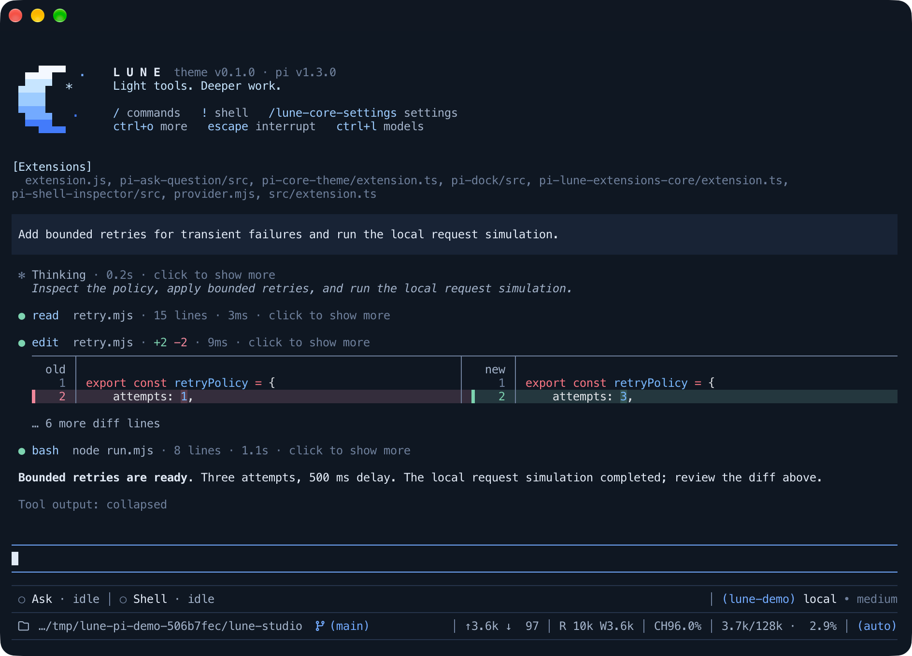](docs/previews/pi-core-dark.png) | [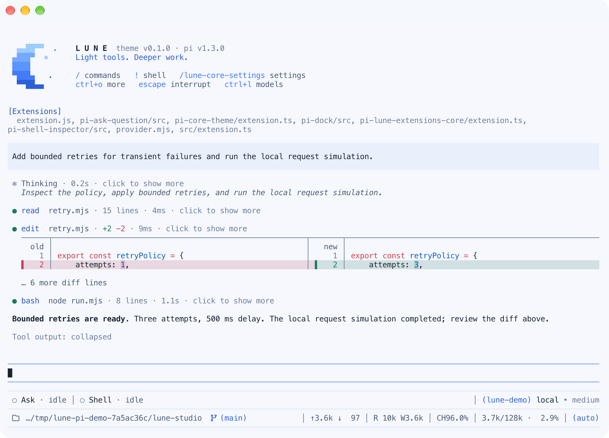](docs/previews/pi-core-light.png) | [](docs/previews/pi-core-aurora.png) | [](docs/previews/pi-core-eclipse.png) |

|                                         Nebula                                          |                                       Dawn                                        |                                       Mist                                        |
| :-------------------------------------------------------------------------------------: | :-------------------------------------------------------------------------------: | :-------------------------------------------------------------------------------: |
| [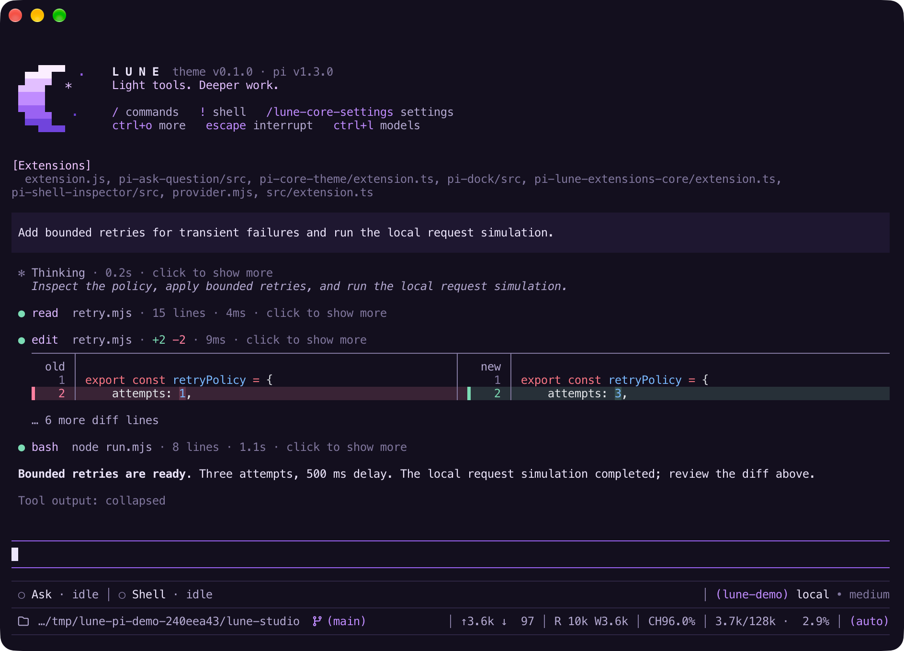](docs/previews/pi-core-nebula.png) | [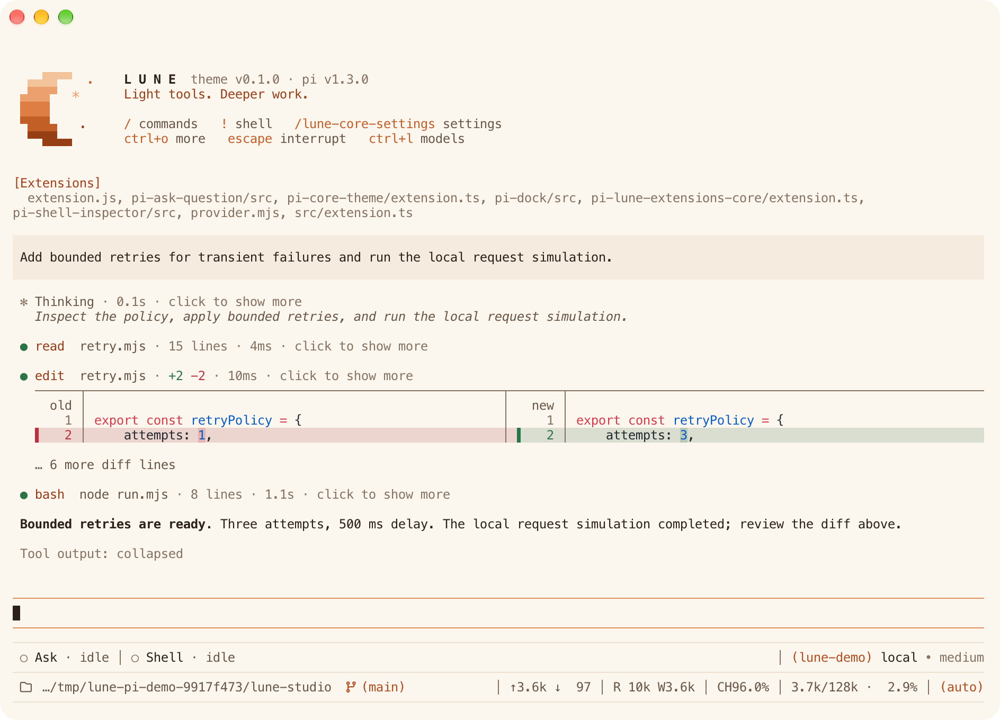](docs/previews/pi-core-dawn.png) | [](docs/previews/pi-core-mist.png) |

<br>

## Develop

Daily development targets the default `dev` branch. Create a topic branch from `origin/dev`, validate it, then merge locally into `dev` and push directly; CI runs after the push. PRs into `dev` are optional. Validated work reaches the stable `main` branch through a promotion PR, and every PR requires explicit prior user consent. See [CONTRIBUTING.md](CONTRIBUTING.md#branch-workflow) for merge methods, hotfixes and release synchronization.

The eight packages share one npm workspace and lockfile, and each has its own version. Run the full check before you send a change:

```bash
npm run check
```

<details>
<summary><b>All workspace commands</b></summary>
<br>

| Command                | What it does                                                 |
| ---------------------- | ------------------------------------------------------------ |
| `npm run build`        | Build Core, then Recap                                       |
| `npm run format`       | Format source, configuration and documentation with Prettier |
| `npm run format:check` | Check formatting without changing files                      |
| `npm run lint`         | Lint TypeScript and JavaScript with ESLint                   |
| `npm run typecheck`    | Build dependencies and typecheck every package               |
| `npm test`             | Build dependencies and run every package's tests             |
| `npm run pack:check`   | Inspect all eight npm tarballs without publishing            |
| `npm run check`        | Run formatting, lint, typechecks, tests and package checks   |

To run a command for one package, give its workspace name or path:

```bash
npm test --workspace=@lune_99/pi-ask-question
npm run tui:demo --workspace=packages/pi-dock
```

</details>

- [CONTRIBUTING.md](CONTRIBUTING.md): architecture, validation and release conventions.
- [Core](packages/pi-lune-extensions-core/README.md): the shared SDK, if you want to build your own extension on Lune.
- [Preview assets](docs/previews/README.md): how to regenerate the screenshots and recording.
- [Root changelog](CHANGELOG.md): repository tooling. Each package keeps its own changelog.

<br>

## License

[MIT](LICENSE)

<div align="center">
<br>
<sub>Made for people who like to see what their agent is doing.</sub>
</div>
