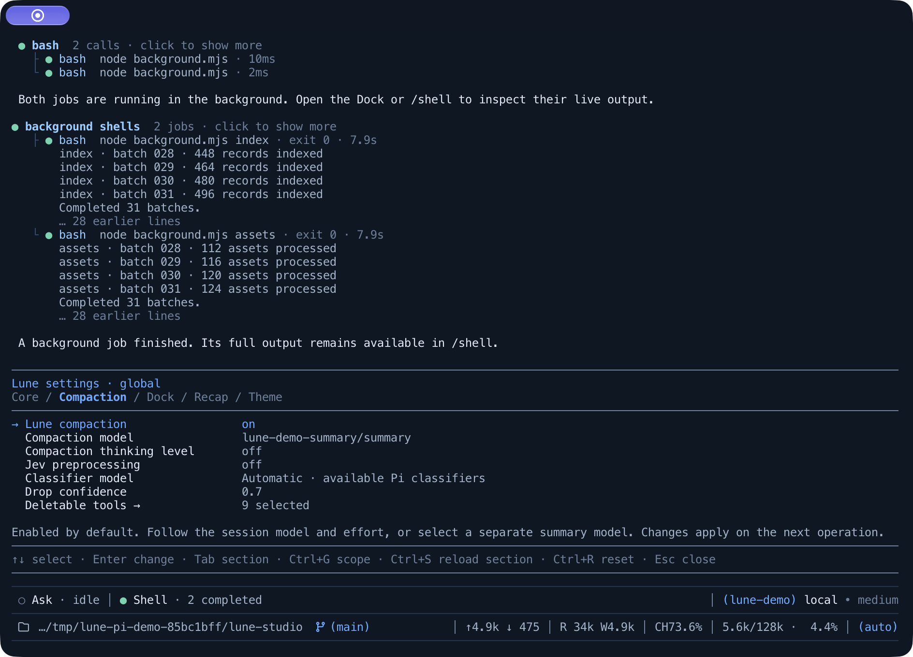
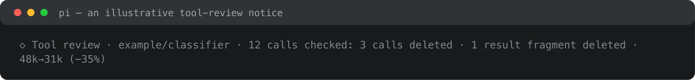

# Lune Compaction

[](https://www.npmjs.com/package/@lune_99/pi-compaction) [](https://www.npmjs.com/package/@lune_99/pi-compaction) [](LICENSE)



**A model of your choice for [Pi](https://pi.dev) compaction, with optional tool-history review.**

Lune Compaction lets summaries follow your session model or use a separate one. Turn on tool-history review to remove disposable output before summarizing, while Pi keeps its normal compaction workflow and session checkpoints.

## Quick start

Install from npm:

```bash
pi install npm:@lune_99/pi-compaction
```

Then start Pi normally:

```bash
pi
```

Lune compaction is on by default. Run `/compact` as usual, or let Pi compact automatically.

## What it does

- **Gives summaries their own model.** Follow the session model and effort, or select a separate summary model with an independent thinking level.
- **Works with native compaction.** Manual, threshold and overflow compaction keep Pi's handling of previous summaries, split turns and file operations.
- **Reviews tool output before summarizing.** An optional classifier judges which result fragments are no longer useful. You choose the confidence threshold and which tools may lose their whole call.
- **Shows what was removed.** A review notice reports the classifier, calls checked, edits and the change in summary-input size.
- **Keeps configuration close.** Pick models and review options in the Compaction settings panel, with global defaults and project overrides.
- **Reports failures explicitly.** A failed summary or classification cancels the operation; cancelled or stale work cannot write a checkpoint.

## Compaction settings

Open:

```text
/lune-core-settings compaction
```

Choose **Follow session model** to use the current model and effort. Selecting a separate **Compaction model** makes **Compaction thinking level** independent.

**Jev preprocessing** is off by default. Enable it to review tool history, then choose a Pi classifier, set **Drop confidence** and select **Deletable tools**. A whole call is removed only when its tool is permitted and every result fragment meets the threshold. Summary models and classifiers come from Pi's configured providers.

`Ctrl+G` switches global/project scope; `Ctrl+R` removes the selected override. Changes apply to the next compaction.

## Tool-history review

An example review notice:



The notice reports the size of the messages entering the summary in characters. Review changes that input; the on-disk tool transcript stays intact.

## Development

```bash
npm install
npm test
npm run typecheck
npm run docs:images # regenerate docs/*.svg + docs/*.png (needs rsvg-convert)
```

## License

MIT
