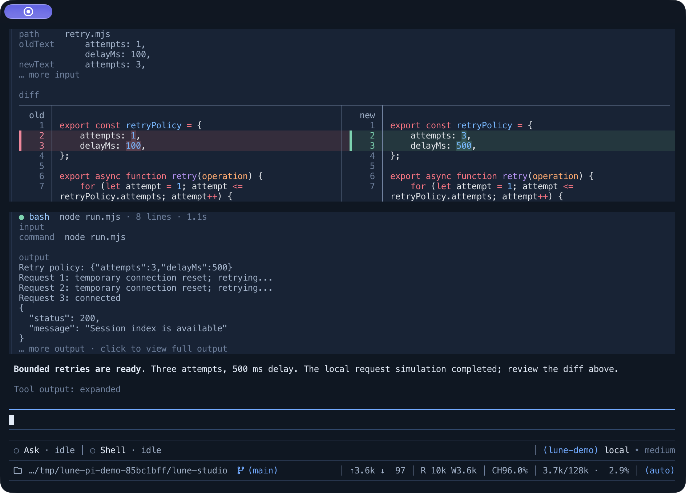
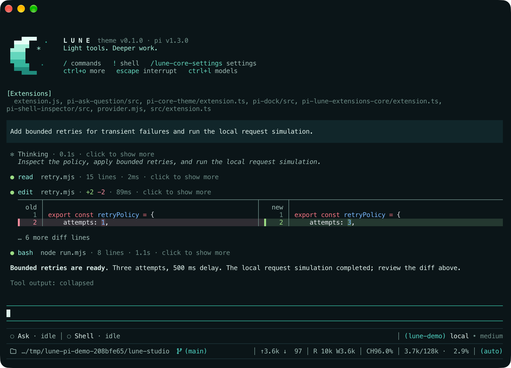
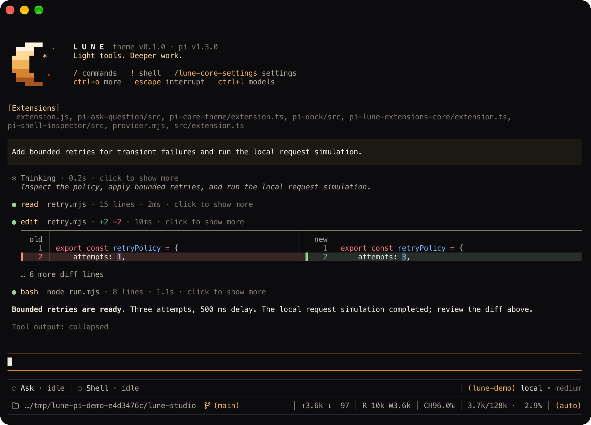
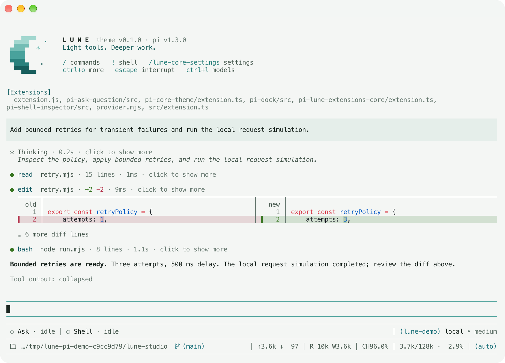

# Lune Core Theme

[](https://www.npmjs.com/package/@lune_99/pi-core-theme) [](https://www.npmjs.com/package/@lune_99/pi-core-theme) [](LICENSE)


**A moonlit workspace for [Pi](https://pi.dev), with compact tool cards, rich diffs and a pixel-moon header.**

Lune Core Theme makes a busy session easier to read. Scan tool activity in a few rows, open the output you need, and see file changes side by side. Seven moonlit palettes, dark and light, carry one set of colors from the header through the whole conversation.

## Quick start

Install from npm:

```bash
pi install npm:@lune_99/pi-core-theme
```

Then start Pi normally:

```bash
pi
```

Open `/lune-core-settings core-theme` and turn **Core theme** on in the **Theme** tab. The theme defaults to off.

## What it does

- **Starts with a little moonlight.** A pixel crescent sits beside the Lune wordmark, versions and configured shortcuts. The header reflows for narrow terminals, and Pi's tool-output toggle reveals the longer help.
- **Keeps tool activity readable.** Individual cards, call trees and compact tool rounds share the same status marks. Collapsed cards take one heading row; expanded cards show arguments and output.
- **Shows the actual change.** Edit and write results use rich diffs with syntax highlighting and inline changes. Automatic layout switches between split and unified views with the terminal width.
- **Follows work as it happens.** Tool groups show their latest calls, expanded cards follow the newest output lines, and thinking updates without keeping everything expanded.
- **Opens longer output when you need it.** Fullscreen interactions let you expand cards and open hidden output in a separate browser with scrolling and copy controls.
- **Adds detail to the conversation.** Markdown gains additional Mermaid dialects, GitHub admonitions and clickable bare URLs. `/context` browses the prompt, memory, skills, tools and messages behind the session.
- **Opens paths and links with Cmd+click.** URLs and existing file paths in messages, tool headings and tool output become terminal links. Files and directories open in their default app. A link is underlined only while the pointer is on it. Terminals without OSC 8 link support show the same text as before.

## Rich diffs



Choose automatic, split or unified diffs in the Theme tab. Tune indicators, wrapping and preview limits, or leave selected tools with their native renderers.

## Palettes

| Dark                                                                      | Light                                                                        | Aurora                                                                          |
| ------------------------------------------------------------------------- | ---------------------------------------------------------------------------- | ------------------------------------------------------------------------------- |
| [](docs/palettes/pi-core-dark.png) | [](docs/palettes/pi-core-light.png) | [](docs/palettes/pi-core-aurora.png) |

| Eclipse                                                                            | Nebula                                                                          | Dawn                                                                      |
| ---------------------------------------------------------------------------------- | ------------------------------------------------------------------------------- | ------------------------------------------------------------------------- |
| [](docs/palettes/pi-core-eclipse.png) | [](docs/palettes/pi-core-nebula.png) | [](docs/palettes/pi-core-dawn.png) |

| Mist                                                                      |
| ------------------------------------------------------------------------- |
| [](docs/palettes/pi-core-mist.png) |

These screenshots show actual Pi sessions in Ghostty, with each palette enabled from startup.

Choose a palette in the Theme tab, or **Inherit Pi theme** to keep your current one:

| Palette               | Mood                             |
| --------------------- | -------------------------------- |
| **Lune Core Dark**    | Moonlight blues on midnight navy |
| **Lune Core Light**   | Moonlight blues on pale paper    |
| **Lune Core Aurora**  | Teal aurora over polar night     |
| **Lune Core Eclipse** | Golden corona on black           |
| **Lune Core Nebula**  | Violet and magenta clouds        |
| **Lune Core Dawn**    | Terracotta sunrise on parchment  |
| **Lune Core Mist**    | Pine teal on sage mist           |

Each palette tints the crescent and thinking levels along its own gradient and keeps distinct success, error and warning tones. It also paints the terminal background and default text in its own colors, so a light palette stays light on a dark terminal profile and the other way around. Turn **Palette background** off to keep your terminal's colors.


Turning **Core theme** off restores Pi's native header, tool rendering, preceding palette and terminal colors.

## Theme settings

The Theme tab groups options under **Style**, **Diff** and **UI**. Choose individual cards, compact tool rounds or native tools; adjust preview sizes and diff layouts; and select the palette you want.

`Ctrl+G` switches global/project scope and `Ctrl+R` removes the selected override. The startup header reads global settings; the rest of the theme also follows trusted-project overrides.

See the [reference guide](docs/reference.md) for interaction details and configuration options.

## Development

```bash
npm install
COLORTERM=truecolor npm test
npm run typecheck
npm run dev
npm run docs:images # regenerate docs/*.svg + docs/*.png (needs rsvg-convert)
```

## License

MIT.
