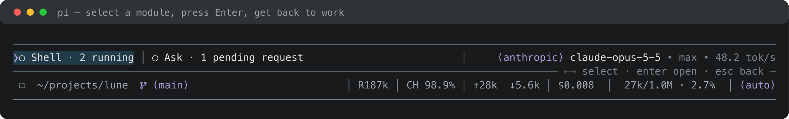
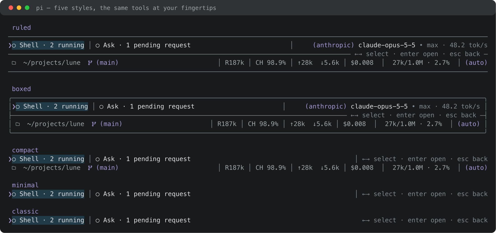

# Lune Dock

[](https://www.npmjs.com/package/@lune_99/pi-dock) [](https://www.npmjs.com/package/@lune_99/pi-dock) [](LICENSE)



**A keyboard-operated dock for [Pi](https://pi.dev), with Lune tools and session statistics in one place.**

Lune Dock brings running shells, pending questions and session usage below the editor. Select a module and press Enter to open its panel, then return to the dock when you close it. Your model, working directory and context use stay alongside the tools.

## Quick start

Install from npm:

```bash
pi install npm:@lune_99/pi-dock
```

Then start Pi normally:

```bash
pi
```

Dock starts enabled with the `ruled` style. Lune Shell Inspector and Lune Ask Question add their modules when installed.

## What it does

- **Brings Lune's signals together.** Shell Inspector shows job activity; Ask Question shows pending requests. Each module opens its existing panel directly.
- **Gets you there from the keyboard.** Press Down in an empty editor, choose a module with Left/Right, and press Enter. Closing the panel returns focus to the dock.
- **Keeps the session in view.** The model and thinking level sit beside the modules. The next row carries the working directory, branch, tokens, cache, cost and context use.
- **Holds the numbers steady.** Usage statistics sit on a fixed grid, so new or changing values never move a bar or a label, and the model lines up with the bars below it.
- **Fits the space you have.** Narrow terminals shorten the directory and drop whole statistic slots. A crowded module row scrolls around your selection.
- **Lets you choose the density.** Pick a style, adjust module detail, hide modules or change their order. Settings apply immediately and persist across sessions.

## Dock styles



| Style | |
| --- | --- |
| `ruled` · default | Rules around the module/model row and directory/usage row |
| `boxed` | The same information in a rounded frame |
| `compact` | Two rows with no frame |
| `minimal` | One row with modules, model and context use |
| `classic` | Modules only, with Pi's existing footer |

Run `/dock` to preview and choose a style. Every style except `classic` replaces Pi's built-in footer; choose `classic` when another extension uses that footer. Folder and branch icons use Nerd Font glyphs.

## Keyboard controls

| Where | Key | Action |
| --- | --- | --- |
| Empty editor | `↓` | Focus Dock |
| Editor | `Super+↓` | Focus Dock while preserving your text |
| Dock | `←` / `→` | Select a module |
| Dock | `Home` / `End` | Jump to the first / last module |
| Dock | `Enter` | Open its panel |
| Dock | `↑` / `Esc` | Return to the editor |
| Dock | Type or paste | Return to the editor and deliver the input |

`Super` is Command on macOS. Editor shortcuts leave autocomplete and other open panels alone; ordinary Down also leaves non-empty editor text alone.

## Dock settings

`/dock` controls the style, module detail, model/workspace/usage rows, hidden modules and module order. `Ctrl+G` switches global/project scope; `Ctrl+R` removes the selected override.

Turning Dock off restores Pi's footer and each contributor's independent status bar. Their commands and panels stay available.

See the [reference guide](docs/reference.md) for settings details and extension integration.

## Development

```bash
npm install
npm test
npm run typecheck
npm run tui:demo
npm run docs:images # regenerate docs/*.svg + docs/*.png (needs rsvg-convert)
```

## License

MIT
