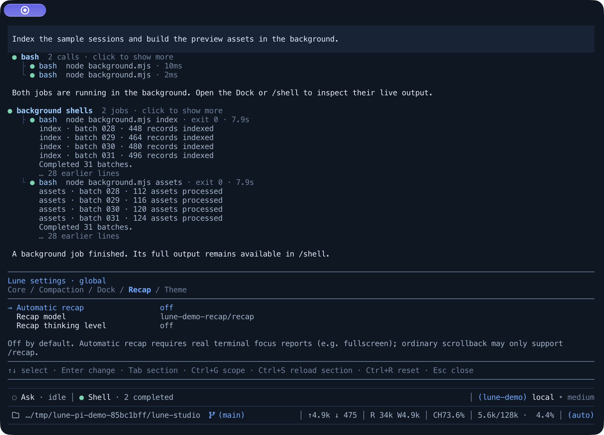

# Lune Recap

[](https://www.npmjs.com/package/@lune_99/pi-recap) [](https://www.npmjs.com/package/@lune_99/pi-recap) [](LICENSE)


**A short reminder for returning to a [Pi](https://pi.dev) session: the goal, the progress and what needs attention next.**

Lune Recap brings the thread back into focus after you step away. Run `/recap` for a reminder near the editor, or enable automatic recaps to have one ready when you return.

## Quick start

Install from npm:

```bash
pi install npm:@lune_99/pi-recap
```

Then start Pi normally:

```bash
pi
```

After the current task and pending prompts finish, run:

```text
/recap
```

## What it does

- **Gets to the point.** A recap covers the active goal, concrete progress, the current blocker and at most one supported next step, following your latest correction and language.
- **Stays close to the editor.** A dim moon-marked widget wraps to the terminal width and clears when you start the next task.
- **Uses the context that matters.** Recaps draw on the retained compaction summary and recent activity, leaving large tool bodies, thinking blocks and images out of the request.
- **Lets you choose the model.** Follow the session model or select a dedicated recap model and thinking level.
- **Reuses a matching recap.** A saved recap can reappear after reload or branch restoration without another model request.
- **Follows the active session.** New input, navigation and model or settings changes invalidate pending generation, so a late answer cannot become a reminder for a different task.

## Automatic recap



Open `/lune-core-settings recap` and turn on **Automatic recap**. It defaults to off; `/recap` works independently of that switch.

Automatic mode uses terminal focus reports. After a substantial completed round — at least five tool results or sixty seconds from prompt to final reply — it waits until three minutes after the agent settles. If the terminal reports that you are away, it can prepare a recap to show when you return. The agent must be idle and pending prompts must be closed.

Use `/recap` in terminals that do not report focus. A recap uses the selected model as a separate request; each attempt, including retries, can incur its normal provider charges.

## Recap settings

The Recap tab controls automatic mode, the recap model, thinking level and **Maximum retries**. The default model follows the session; recap thinking defaults to `off`.

Maximum retries defaults to `3`: the initial request plus up to three retries, for at most four attempts. Set it to `0` to disable retries. Both manual and automatic recaps use Pi's retry policy for temporary provider errors only. Non-retryable errors, incomplete responses (including `toolUse` and `length`), tool calls and empty text end the operation without another attempt.

Intermediate failures stay silent. A successful retry shows the recap normally; a final failure produces one warning with the actual attempt count. Cancellation produces no warning. Automatic mode does not repeat a failed snapshot, including after reload; run `/recap` to start a fresh attempt sequence. Final failure records retain bounded protocol metadata, attempt counts and a Recap-owned error summary, not raw provider errors or response content.

`Ctrl+G` switches global/project scope; `Ctrl+R` removes the selected override. Changing Maximum retries does not regenerate a matching saved recap. Recaps are limited to 400 characters and wrap near the editor.

## Development

```bash
npm install
npm run build
npm test
npm run typecheck
npm run tui:demo
npm run tui:smoke
npm run docs:images # regenerate docs/*.svg + docs/*.png (needs rsvg-convert)
```

## License

MIT
